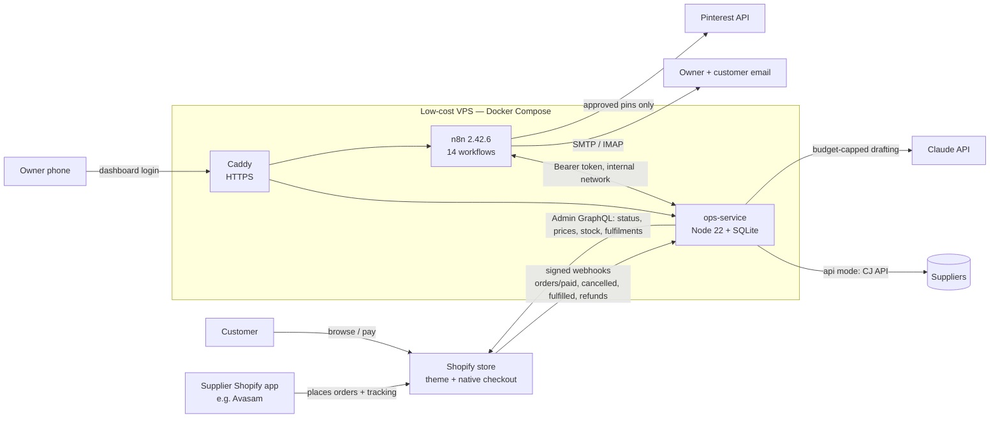

# Architecture

## Responsibilities

| Component | Responsibility | Why here |
|---|---|---|
| **Shopify** | Catalogue, storefront, cart, **checkout and payments**, customer notifications, tax settings | Never build our own checkout or touch card data |
| **Theme** (`shopify-theme/`) | Online Store 2.0 theme: homepage, collections, product pages, cart, content pages | Mobile-first, accessible, no fake reviews or urgency |
| **ops-service** (`ops-service/`) | All business rules and safety checks: HMAC webhook verification, idempotent order pipeline, pricing/profit engine, product scoring, supplier adapters, inventory/price monitors, tracking sync, support classifier, returns cases, marketing approval queue, reports, emergency pauses, owner dashboard, backups | Logic lives in plain, unit-tested code (65 tests) rather than in visual workflows that are hard to test |
| **n8n** (`n8n-workflows/`) | Scheduling and orchestration: triggers, retries, email in/out, Pinterest publishing, error workflow | Easy for a non-programmer to see and pause; holds third-party credentials |
| **Caddy** | Automatic HTTPS; exposes only the webhook endpoint, dashboard and health check of ops-service | Smallest possible public surface |

## Order flow (Workflows 05 → 06 → 07)
1. Shopify sends `orders/paid` to `https://ops.<domain>/webhooks/shopify`.
2. ops-service verifies the **HMAC** against the raw body and checks the shop domain. It records the webhook ID: a duplicate delivery is acknowledged and ignored. It stores a **minimised** copy of the order.
3. It forwards `{orderId}` to n8n Workflow 05 (shared-secret header). If n8n is down, Workflow 05's 15-minute fallback picks up any paid order not yet evaluated.
4. Workflow 05 calls `/api/orders/:id/evaluate`, which:
   - confirms **PAID** with Shopify (not trusting the webhook body);
   - checks cancellation, Shopify **fraud risk** and hold tags, currency, delivery country;
   - checks SKU → supplier mapping, product approval and stock;
   - applies the **pause switch**, per-order value limit and daily spend cap.

   Outcome: `auto_submit`, `approval` (dashboard queue), `hold` (exception), or `app_managed`.
5. Workflow 06 calls `/api/orders/:id/submit`. One supplier order per (order, supplier) is enforced by a **UNIQUE key and an atomic claim**. Definite failures retry up to 3 times. **Ambiguous failures (timeouts) are never retried automatically**; they raise a critical alert.
6. Workflow 07 polls supplier tracking every 2 hours (or accepts pushed tracking) and creates the Shopify fulfilment, which emails the customer. Only supplier-provided tracking numbers are used.

## Supplier modes
`app_managed` (supplier app places orders; we monitor only), `api` (we submit; CJ adapter, orders created unpaid by default), `manual` (purchase task in your approval queue), `mock` (test mode). A supplier can only have one mode, which prevents double-ordering.

## Human-in-the-loop by design
| Action | Automatic? |
|---|---|
| Publishing a new product | **No**: draft + owner approval |
| Price change ≤10% that keeps margin rules | Yes (unless paused) |
| Larger price change | **No**: approval; never below break-even |
| Supplier order within limits | Yes (unless paused) |
| Supplier order over limit / medium risk / manual supplier | **No**: approval |
| Refunds | **Never**: approval, then issued by you in Shopify |
| Marketing publication | Only content you approved |
| Customer replies | Only routine, verified categories; everything else escalates |

## Data
SQLite (`/data/ops.sqlite`) holds operational data only. PII is minimised and purged 90 days after completion. Logs are redacted and kept 90 days. Shopify remains the system of record for orders and accounting exports.

## Test mode
`TEST_MODE=true` (the default) swaps in a simulated Shopify and simulated suppliers. The n8n Config node's `testMode: true` sends all customer emails to the owner and skips Pinterest publishing. Switch both off only via `LAUNCH-CHECKLIST.md`.
